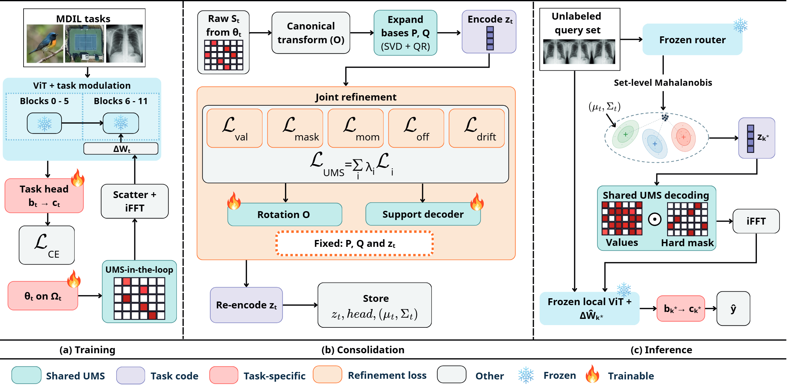

# FOCAL-UMS

FOCAL-UMS learns task-specific sparse Fourier modulations for a frozen ViT-B/16
and encodes them as fixed-length diagonal codes in a shared Unified Modulation
Subspace (UMS). A shared rotation and support decoder are refined after each
task. At inference, a Gaussian-memory router selects one expert for each
single-domain query set and decodes its modulation.

<p align="center">
  
</p>


## Setup

Python 3.10 and a CUDA-capable GPU are recommended.

```bash
git clone https://github.com/thuir184/UMS.git
cd UMS

python -m venv .venv
# Linux/macOS: source .venv/bin/activate
# Windows: .venv\Scripts\activate

pip install -r requirements.txt
```

The dataset loaders expect data under `./data/`. The preprocessed benchmark can
be downloaded from Hugging Face:

```bash
huggingface-cli download nguyenhieu3205xt/lear-reproduce-data \
  --repo-type dataset \
  --local-dir ./data
```

## Reproduce the paper protocol

Run one task order and one seed:

```bash
python training_scripts/train_focal.py --orders eti --seeds 0
```

Run all three task orders and seeds used in the paper:

```bash
python training_scripts/train_focal.py \
  --orders eti cdm trc \
  --seeds 0 1 2
```

Preview the generated commands without training:

```bash
python training_scripts/train_focal.py --orders eti cdm trc --seeds 0 1 2 --dry-run
```

The paper configuration uses a frozen `vit_base_patch16_224`, blocks 6–11,
5,898 Fourier coefficients per modulated branch and task, UMS capacity 768,
per-task SVD rank 75, Adam with learning rate `1e-3`, batch size 64, and 10
epochs per task. The complete configuration is defined in
[`training_scripts/train_focal.py`](training_scripts/train_focal.py).

## Evaluation protocol

Evaluation follows the grouped-domain protocol used in the paper: every query
set contains samples from one unknown dataset, and one expert is selected for
the entire set using average Mahalanobis distance. The evaluated loader supplies
the class cardinality used to truncate logits. This is not per-sample global
class-incremental inference.

Generated checkpoints and results are written locally and excluded by
`.gitignore`.

## Acknowledgements

This code builds on
[Mammoth](https://github.com/aimagelab/mammoth) and
[LEAR](https://github.com/yrluestc/NeurIPS2025-LEAR). See
[`THIRD_PARTY_NOTICES.md`](THIRD_PARTY_NOTICES.md) for attribution.

Released under the terms in [`LICENSE`](LICENSE).
